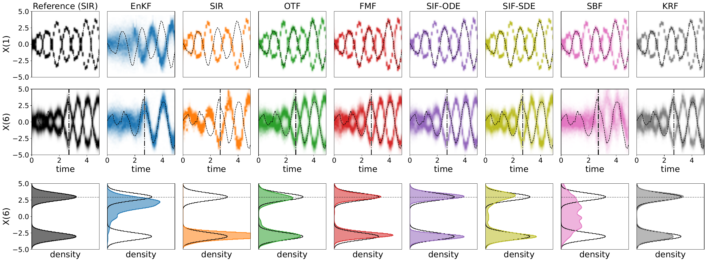
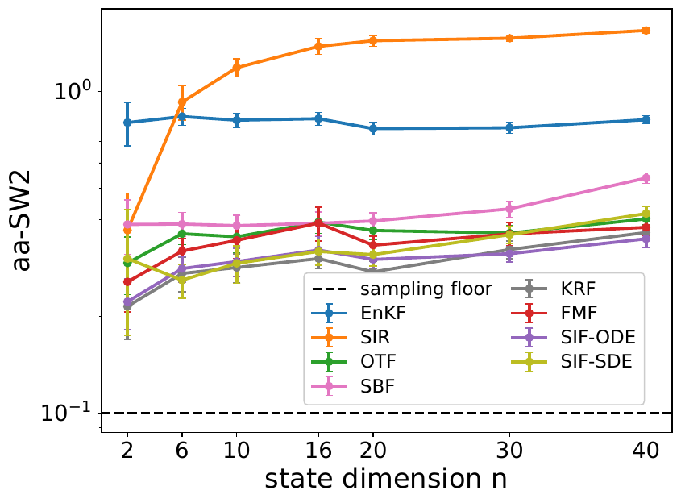
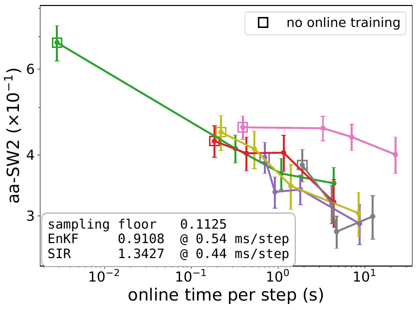
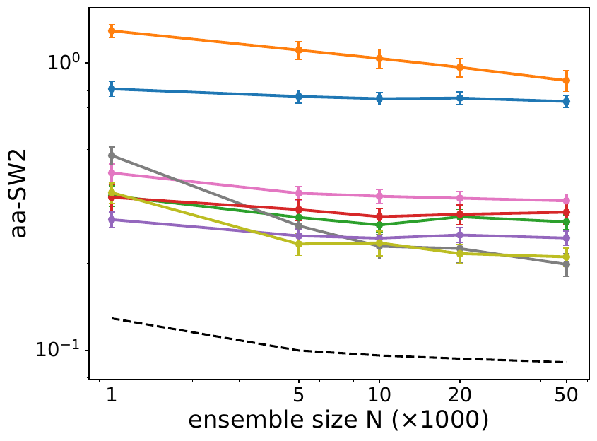
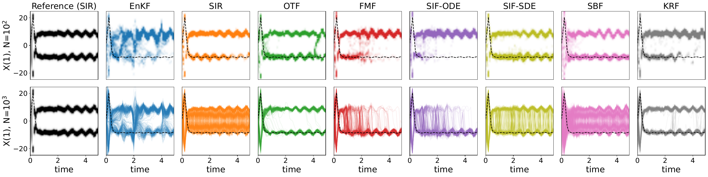
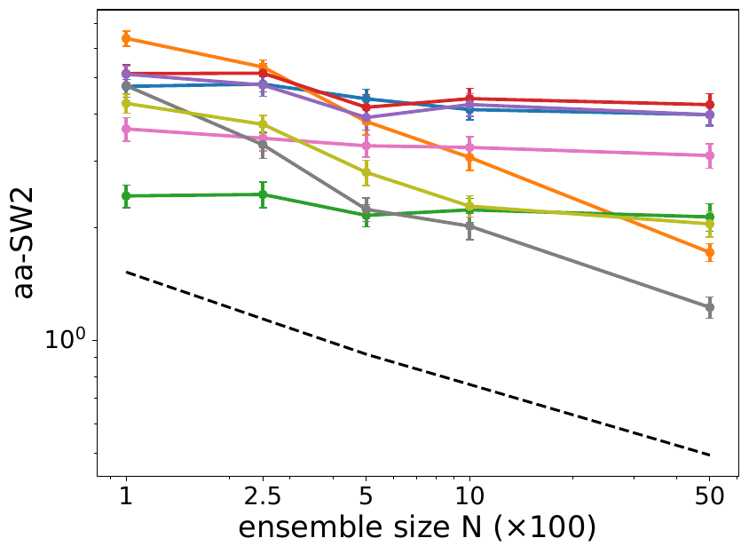

# Generative Models for Simulation-Based Filtering

Code accompanying

> **[Generative models for simulation based filtering: Formulations and Empirical Comparisons](https://arxiv.org/abs/2609.16317)**
> 
> [Mohammad Al-Jarrah](https://sites.google.com/view/mohammadaljarrah), [Wei Deng](https://www.weideng.org), [Bamdad Hosseini](https://bamdadhosseini.org/), [Amirhossein Taghvaei](https://amirtag.github.io)

The paper gives a unified formulation of generative-model approaches to nonlinear
filtering, in which the analysis (conditioning) step is realized by a **triangular
transport** of the forecast distribution to the posterior, and the methods differ
only in how that transport is selected and learned. Three filters are derived here
— from stochastic interpolants, their deterministic flow-matching limit, and
Schrödinger bridges — and compared against established alternatives under identical
ensembles, a common metric, and matched computational budgets.

---

## The filters

| Filter | Transport / coupling | Learning | Inference | File |
|---|---|---|---|---|
| **OTF** | optimal-transport map `T` | adversarial max–min | one-shot | `OTF.py` |
| **KRF** | Knothe–Rosenblatt map `S` | maximum likelihood | one-shot, safeguarded Newton | `KRF.py` |
| **FMF** | deterministic interpolant | regression | ODE, Euler steps | `FMF.py` |
| **SIF-ODE** | stochastic interpolant (ε>0, λ=0) | regression | ODE | `SIF.py` |
| **SIF-SDE** | stochastic interpolant (ε>0, λ=1) | regression | SDE | `SIF.py` |
| **SBF** | forward/backward drifts | minimum energy (Schrödinger bridge) | reversed SDE | `SBF.py` |
| **EnKF** | — (Gaussian ansatz) | trains nothing | one-shot | `EnKF.py` |
| **SIR** | — (importance weights) | trains nothing | resampling | `SIR.py` |

`SIF.py` implements both SIF variants; which one runs is set by the
`(NOISE_LEVEL, DENOISER_WEIGHT, INFERENCE_MODE)` triple in its parameter dict.
EnKF and SIR are flat baselines: they train nothing, take no warm start, and have
no online budget.

**Accuracy metric.** All comparisons use the axis-aligned sliced Wasserstein-2
distance (aa-SW2) between the filter ensemble and a reference posterior, averaged
over the state coordinates and over the analysis steps. Every figure also reports a
**sampling floor** — the aa-SW2 between an *independent* draw of the same size from
the reference and the reference itself — which is the error induced purely by a
finite ensemble and which no algorithm is expected to beat.

---

## Repository layout

### Filter implementations

| File | Purpose |
|---|---|
| `EnKF.py` | Ensemble Kalman filter — baseline, trains nothing |
| `SIR.py` | Sequential importance resampling particle filter — baseline, also used to build the reference posteriors |
| `OTF.py` | Optimal transport filter — adversarial max–min training of a critic/map pair |
| `KRF.py` | Knothe–Rosenblatt rearrangement filter — monotone triangular map (Gauss–Legendre quadrature), inverted coordinate-wise by safeguarded Newton |
| `FMF.py` | Flow matching filter — deterministic interpolant, ODE inference |
| `SIF.py` | Stochastic interpolant filter — both the ODE (λ=0) and SDE (λ=1) variants |
| `SBF.py` | Schrödinger bridge filter — forward–backward SDE, IPF-style alternating training |
| `timing_utils.py` | `sync_clock`, a CUDA-aware wall clock so per-analysis-step timings measure execution rather than kernel launch |

### Hyperparameters

| File | Purpose |
|---|---|
| `param_one_step.py` | **Stage-1 incumbents** — the cold spin-up configuration (architecture, learning rate, batch size, training budget) for every learned method |
| `param_multi_steps_fi.py` | **Stage-2 incumbents**, keyed by `(method, FI)` — the online-refinement configuration at each budget level. This is what the experiment scripts read |

### Tuning (stages 1 and 2)

| File | Purpose |
|---|---|
| `tuning_stage_one.py` | Stage-1 SMAC tuner: searches the cold spin-up hyperparameters at `T = 2`, one method at a time. Writes `logs/best_one_step_<method>_sim2.json` |
| `tuning_stage_two.py` | Stage-2 SMAC tuner: warm-starts from the stage-1 weights and searches only the online-refinement optimizer knobs, at one budget level per run. Writes `logs/best_multi_steps_<method>_fi<FI>_sim2.json` |

### Experiments

| File | Purpose |
|---|---|
| `Quadratic.py` | Full particle-trajectory run of the quadratic benchmark at one budget — the data source for the density figures |
| `Quadratic_vs_final_iter.py` | Error and cost vs **online budget** (`FI ∈ {0, 1, 4, 16}`) |
| `Quadratic_vs_dim.py` | Error and cost vs **state dimension** (`n ∈ {1, 3, 5, 8, 10, 15, 20}`, i.e. `L = 2n`) |
| `Quadratic_vs_particles.py` | Error and cost vs **ensemble size** (`N ∈ {1000, …, 50000}`) |
| `L63.py` | Lorenz-63 transfer test — the quadratic-tuned configurations applied unchanged, running both phases back to back |
| `L63_vs_particles.py` | Lorenz-63 error and cost vs **ensemble size** (`N ∈ {100, …, 5000}`) |
| `Quadratic_select_method.py` | Regenerates one method's stage-1 warm-start checkpoints at every dimension the Quadratic scripts need — **required for KRF at `L ≥ 20`**, see [Files not distributed at full size](#files-not-distributed-at-full-size) |

### Figures

| File | Purpose |
|---|---|
| `import_data.py` | **Every figure in the paper**, redrawn from the saved archives. No filter is ever re-run here |

### Data and outputs

| Path | Purpose |
|---|---|
| `DATA/` | `.npz` archives written by the experiment scripts and read by `import_data.py` |
| `DATA/warm_start/` | `.pt` checkpoints that join the two tuning stages |
| `logs/` | SMAC incumbents (`best_*.json`) and run logs |
| `figs/` | Generated figures; `figs/plotting_figures/` holds the subset used in the paper |

---

## Requirements

```
python >= 3.9
torch
numpy
scipy
scikit-learn
matplotlib
smac            # only for tuning_stage_one.py / tuning_stage_two.py
ConfigSpace     # only for the tuners
```

A CUDA GPU is strongly recommended: the learned filters train a network at every
analysis step. Each script selects its device through a `GPU_IDS` list near the top,

```python
GPU_IDS = [0]          # add indices, e.g. [0, 1, 2], to spread filters over more GPUs
```

which defaults to one GPU and falls back to the CPU when none is visible. The
experiment scripts dispatch the filters concurrently across whatever devices are
listed; with a single device they run sequentially.

### Run options

Every experiment script (`Quadratic.py`, `L63.py`, `Quadratic_vs_*.py`,
`L63_vs_particles.py`) reads four optional environment variables. Left unset, the
script runs exactly the configuration behind the paper's figures.

| Variable | Effect |
|---|---|
| `ONLY_METHODS` | comma list of methods to run, e.g. `KRF,SBF`; the others are skipped and left out of the archive |
| `TAG` | appended to every output file name, so a reproduction run never overwrites the archives shipped in `DATA/` |
| `RANDINT` | pins the seed; the truth trajectories, observations, initial ensembles and reference posterior are all drawn from it before any filter runs |
| `GPU_IDS` | comma list of CUDA device indices, overriding the `GPU_IDS` list in the file |

`L63.py` also reads `N` (the paper uses `N=100` and `N=1000`), and
`Quadratic_select_method.py` reads `METHOD`. For example, to reproduce the KRF
curve of the online-budget sweep without touching the shipped archive:

```bash
ONLY_METHODS=KRF TAG=_repro python Quadratic_vs_final_iter.py
```

---

## How the results were produced

Tuning is split into two stages joined by a **weight cache**, because the two
training regimes want different settings: stage 1 trains a network from nothing and
wants a large budget and a high learning rate, while stage 2 nudges an already-good
network and wants a small one (measured: FMF's learning rate fell by a factor of 20
between the stages). Every arrow below is a deliberate manual paste, so that a sweep
can never silently change what the next stage starts from.

```
 STAGE 1                    BETWEEN                      STAGE 2                      EXPERIMENTS
 tuning_stage_one.py        run incumbent once           tuning_stage_two.py          Quadratic_vs_*.py
 T = 2                      warm_start='save'            T = 20                       L63*.py
 warm_start='off'           trains once, saves .pt       warm_start='require'         warm_start='require'
 tunes the spin-up          --------------------->       tunes online refinement      no retuning at all
        |                          |                            |                           |
        v                          v                            v                           v
 best_one_step_*.json  -->  param_one_step.py  -->  DATA/warm_start/*.pt  -->  best_multi_steps_*.json
                                                                           -->  param_multi_steps_fi.py
```

1. **Stage-1 tuning** — `tuning_stage_one.py`, one method at a time, 100 SMAC trials
   each, scored on a single analysis step (`T = 2`, `NUM_SIM = 2`). Searches the
   architecture, learning rate, batch size and spin-up budget.
2. **Save the weights** — the stage-1 incumbent is pasted into `param_one_step.py`
   and run **once** with `warm_start='save'`, writing
   `DATA/warm_start/<method>_quadratic_L<L>_dy<dy>_<arch>_<digest>.pt`. The write
   happens outside the sweep on purpose: with parallel trials sharing an
   architecture, the file left on disk would be whichever trial finished last rather
   than the best one.
3. **Stage-2 tuning** — `tuning_stage_two.py`, warm-starting from those weights under
   `warm_start='require'` so a missing checkpoint is a loud failure instead of a trial
   that silently trains cold. The architecture is frozen (the checkpoint filename
   encodes it); only the optimizer knobs and the online budget are searched. Run once
   per budget level — `FI ∈ {1, 4, 16}` — and the incumbents pasted into
   `param_multi_steps_fi.py`. The fourth level, `FI = 0`, is **not** a tuned cell: it
   is stage 1's configuration with the online budget set to zero, so every filter
   loads its spin-up checkpoint and trains at no analysis step. It is the
   no-adaptation baseline the rest of each curve is read against.
4. **Experiments** — the tuned configurations are then stressed along three axes of
   the benchmark they were fitted on, and finally on a different system entirely,
   with **no retuning anywhere**:

   | Step | Script | Axis |
   |---|---|---|
   | 4 | `Quadratic_vs_final_iter.py` | online budget, `FI ∈ {0, 1, 4, 16}` |
   | 5 | `Quadratic_vs_dim.py` | state dimension, `n ∈ {1, 3, 5, 8, 10, 15, 20}` |
   | 6 | `Quadratic_vs_particles.py` | ensemble size, `N ∈ {1000, …, 50000}` |
   | 7 | `L63.py` | transfer to Lorenz-63 |
   | 8 | `L63_vs_particles.py` | Lorenz-63 ensemble size, `N ∈ {100, …, 5000}` |

   Shared protocol for the sweeps: `T = 20`, `NUM_SIM = 20`, `N_true = 2000`.
   `NUM_SIM = 20` is what gives the error bars; the tuners used 2 because they were
   screening rather than reporting. Every sweep records **computational time
   alongside error**, because the budgets are not compute-matched across methods —
   an iteration axis would compare unlike things, so the headline plot is against
   compute.

   Step 5 needs its own checkpoint at **every** dimension: a network's input layer is
   sized from `L` and `dy`, so a checkpoint fitted at one dimension cannot load at
   another. Step 6 needs none — the digest deliberately excludes `N`, since the
   network has the same shape at any ensemble size.

5. **Figures** — `import_data.py` reads the `.npz` archives and draws every panel.
   No filter is re-run at this stage, so the figures can always be regenerated from
   the archives alone.

---

## Benchmark 1 — the quadratic observation model

```
Xt = F X_{t-1} + σ Vt ,        Yt = H(Xt) + γ Wt
```

with `{Vt}`, `{Wt}` mutually independent sequences of i.i.d. standard Gaussian
vectors. `F` is block diagonal, assembled from `m` decoupled two-dimensional blocks,
each a stable oscillatory rotation:

```
F = I_m ⊗ F_block ,    F_block = [[ a, −b ],      a = 0.99 α ,  b = √(1 − α²) ,  α = 0.9
                                  [ b,  a ]]
```

The observation map is **quadratic** and acts on the first coordinate of each block,
so exactly one coordinate per block is observed directly:

```
H(x) = ( x₁², x₃², … , x²_{2m−1} )
```

Remaining parameters: `X₀ ∼ N(0, I)`, `σ² = γ² = 10⁻¹`.

Although the dynamics are linear, the quadratic observation leaves the **sign** of
each observed coordinate unresolved, so the posterior is **bimodal along the entire
trajectory** — which is what makes this a discriminating test.

In the code, `n` is the number of blocks, so `L = 2n` states and `dy = n`
observations; the default run is `n = 5` (`L = 10`, `dy = 5`) at `N = 10⁴`.

The reference posterior exploits the block structure: SIR suffers the curse of
dimensionality in the full state, so independent two-dimensional SIR filters are run
**per block** with `10⁵` particles each and the marginals stacked.

### Posterior densities

<p align="center">
  
</p>

Marginal posterior densities at `n = 10` states, `N = 10⁴`. The leading column is the
reference; the dashed line is the true state. The upper two rows show the time
evolution of the observed coordinate `X(1)` (observed through its square, so its sign
is unresolved) and the unobserved coordinate `X(6)`; the lower row is the marginal
density of `X(6)` at `t = 2.7`, marked by the vertical line, with the reference in
outline. All generative filters recover the bimodal structure with the exception of
SBF, while SIR shows mode collapse — its ensemble concentrating on one mode — and the
EnKF cannot represent bimodality at all, as a Gaussian ansatz must.

### Error vs state dimension

<p align="center">
  
</p>

At fixed `N = 10⁴`. SIR degrades quickly with dimension, consistent with the known
weight degeneracy; the EnKF is nearly independent of `n` and remains high throughout.
Every generative filter lies well below both at every dimension and degrades only
mildly, with SBF the weakest of them. KRF and SIF-ODE attain the lowest errors at most
dimensions, but the online cost of KRF grows linearly with `n`, since its map is
inverted one coordinate at a time.

### Error vs online cost

<p align="center">
  
</p>

The four budget levels re-plotted against what they *cost* rather than against the
iteration count. The ringed markers are the zero-budget point — stage 1's network
with no online training at all. OTF benefits most from online refinement, its error
falling by roughly a factor of two; SBF benefits only moderately, and the error of KRF
decreases up to the third budget level and then saturates. KRF at the third budget
level and the SIF configurations at the highest budget attain the lowest errors, at a
cost some four orders of magnitude above the EnKF and SIR, whose values are reported
in the box rather than plotted.

The same results as a table — online time per analysis step (seconds) and
time-averaged aa-SW2 (mean ± standard error over 20 simulations), `n = 10`,
`N = 10⁴`. The budget level `f` sets the number of optimizer iterations per analysis
step: `16f` for OTF and SBF, `256f` for FMF and SIF, `64f` for KRF. The sampling floor
is 0.113.

| Method | `f = 0` time | `f = 0` aa-SW2 | `f = 1` time | `f = 1` aa-SW2 | `f = 4` time | `f = 4` aa-SW2 | `f = 16` time | `f = 16` aa-SW2 |
|---|---:|---:|---:|---:|---:|---:|---:|---:|
| EnKF | 0.0004 | 0.907 ± 0.044 | 0.0005 | 0.910 ± 0.046 | 0.0005 | 0.912 ± 0.045 | 0.0007 | 0.914 ± 0.047 |
| SIR | 0.0003 | 1.339 ± 0.076 | 0.0005 | 1.350 ± 0.086 | 0.0004 | 1.337 ± 0.077 | 0.0006 | 1.345 ± 0.084 |
| OTF | 0.0028 | 0.680 ± 0.057 | 0.32 | 0.413 ± 0.027 | 1.09 | 0.367 ± 0.027 | 4.41 | 0.350 ± 0.027 |
| FMF | 0.19 | 0.427 ± 0.032 | 0.43 | 0.403 ± 0.032 | 1.16 | 0.404 ± 0.034 | 4.40 | 0.320 ± 0.036 |
| SIF-ODE | 0.70 | 0.395 ± 0.029 | 0.92 | 0.336 ± 0.025 | 1.81 | 0.340 ± 0.024 | 8.70 | 0.289 ± 0.027 |
| SIF-SDE | 0.22 | 0.446 ± 0.036 | 0.53 | 0.412 ± 0.037 | 1.41 | 0.346 ± 0.036 | 8.46 | 0.304 ± 0.031 |
| SBF | 0.39 | 0.456 ± 0.025 | 3.30 | 0.454 ± 0.026 | 7.08 | 0.435 ± 0.027 | 22.55 | 0.401 ± 0.034 |
| KRF | 1.90 | 0.381 ± 0.029 | 4.17 | 0.318 ± 0.028 | 4.72 | 0.278 ± 0.021 | 12.36 | 0.299 ± 0.031 |

Times are GPU wall-clock seconds per analysis step, excluding the first (spin-up)
step. Both columns are read from `DATA/DATA_file_Quadratic_vs_final_iter.npz`:
`online` for the time and `sw2_mean`, `sw2_std / √20` for the error.

### Error vs ensemble size

<p align="center">
  
</p>

At fixed `n = 10`. The error of the generative filters other than KRF and SIF-SDE
depends only weakly on `N` and stays well above the sampling floor across the range,
indicating that their residual error is dominated by the approximation quality of the
learned map rather than by the ensemble size. KRF, in contrast, improves markedly with
`N` — it is the least accurate generative filter at `N = 10³` and the most accurate
at `N ≥ 10⁴` — suggesting a sample-limited estimate.

---

## Benchmark 2 — Lorenz-63

The three-dimensional chaotic Lorenz-63 system,

```
dx₁/dt = σ_L (x₂ − x₁)
dx₂/dt = x₁ (ρ − x₃) − x₂           σ_L = 10 ,  ρ = 28 ,  β = 8/3
dx₃/dt = x₁ x₂ − β x₃
```

integrated with classical RK4 over each analysis interval (`τ = 0.1`, covered by 10
substeps of `10⁻²` — a single explicit step of `τ` is not accurate enough for the
propagated ensemble to be a forecast of the same system the truth was drawn from).

**Only the third component is observed:**

```
Yt = x₃(t) + γ Wt
```

with `L = 3`, `dy = 1`, `σ = √10 / 10` (process noise assumed by the filters),
`γ = √10`, `σ₀ = 10`, and `T = 50` analysis steps spanning 5 time units — about 4.5
Lyapunov times at these parameters. Observing one coordinate of three, over a chaotic
orbit, leaves a **sign symmetry** that makes the posterior bimodal in the first two
components.

This benchmark is a **transfer test**: every hyperparameter is a stage-2 incumbent
searched on the quadratic benchmark at `L = 10, dy = 5` and applied here unchanged —
nothing is re-searched at either stage. The *weights* cannot transfer, since each
network's input layer is sized from `L` and `dy`, so `L63.py` runs both phases back to
back: Phase 1 trains fresh spin-up weights under the stage-1 configuration (tag
`lorenz63`), and Phase 2 loads exactly those under `'require'` and runs the stage-2
budget. What is tested is the transfer of the *tuning*, not of the trained maps.

Lorenz-63 does not factorise, so unlike the quadratic benchmark the reference is a
single SIR run in the full 3-D state with a very large ensemble — accurate, but not
exact.

### Posterior densities and particle trajectories

<p align="center">
  
</p>

First coordinate at `N = 10²` (upper row) and `N = 10³` (lower row); the leading
column is the reference and the dashed line is the true state. At the smaller ensemble
size FMF and SIF-ODE struggle to recover the bimodal posterior, whereas OTF, KRF,
SIF-SDE and SBF resolve both modes. The trajectories also show that for the
non-transport-based methods particles frequently **switch between the two modes**
across successive analysis steps, while OTF and KRF tend to preserve the mode occupied
at the previous step.

### Error vs ensemble size

<p align="center">
  
</p>

OTF achieves the lowest error for `N ≤ 500`, and KRF for `N ≥ 10³`. (The archive also has an `N = 10⁴`
column, which is left empty for KRF and SBF; the figure stops at `N = 5000`.) The ranking does
**not** fully survive the move from the quadratic benchmark: FMF and SIF-ODE,
competitive there, are among the least accurate generative filters here, so whatever
the stage-2 search bought, it did not buy an ordering that holds on a different
system.

---

## Implementation notes

Details that the paper leaves out for space, but that matter for reproducing it.

**Online budgets.** The budget level `f` (`FI` in the code) is a raw multiplier; the
number of optimizer iterations per analysis step is `f` times a per-method base
(`FI_BASE` in `param_multi_steps_fi.py`):

| Method | base | `f = 0` | `f = 1` | `f = 4` | `f = 16` |
|---|---:|---:|---:|---:|---:|
| FMF, SIF-ODE, SIF-SDE | ×256 | 0 | 256 | 1024 | 4096 |
| KRF | ×64 | 0 | 64 | 256 | 1024 |
| OTF, SBF | ×16 | 0 | 16 | 64 | 256 |

The budgets are therefore not matched in iterations across methods, which is why the
results are reported against computational time.

**KRF.** Each component of the monotone triangular map is
`S_k(ctx, x_k) = c_k(ctx) + ∫₀^{x_k} s_k(ctx, t) dt` with a positive slope `s_k`. The
integral is evaluated by a 16-node Gauss–Legendre rule, and the log-determinant in the
likelihood uses `s_k(ctx, x_k)` itself; with Gauss–Legendre weights the two agree to
quadrature accuracy, so the training objective is the likelihood of the same map that
is inverted at the analysis step. The inversion solves `S_k(ctx, x_k) = z_k` one
coordinate at a time by safeguarded Newton (Numerical Recipes' `rtsafe`: a step that
leaves the bracket, or fails to halve the step before last, is replaced by bisection),
which reaches the bisection solution to within `10⁻⁶` in a few iterations;
`INVERSION='bisection'` selects plain 60-step bisection instead.

**SBF.** The forward and backward SDEs are integrated on `SDE_STEPS + 1` grid points
covering the closed interval `[0, T]` (`SDE_STEPS = 80`). The first analysis step of
each simulation trains over `NUM_STAGES` stages of the alternating procedure, and
every later step refines over one stage; the stage count and the spin-up budget are
restored at the start of every simulation, so independent cold-start simulations
(stage-1 tuning runs two) are trained identically.

**Reference posterior and sampling floor.** The reference is a SIR filter run with
`10⁵` particles per two-dimensional block for the quadratic model (the blocks are
independent, so the per-block posteriors are exact and are stacked) and `10⁶`
particles for Lorenz-63. Of these, `2 × 10³` particles are kept as the reference
ensemble that aa-SW2 is computed against. The sampling floor is the aa-SW2 of `N`
further particles from the same SIR run, disjoint from the kept reference ensemble.

**Warm-start checkpoints.** A checkpoint name encodes the architecture and a digest of
every setting that changes the meaning of the stored weights (noise levels,
normalization, KRF's quadrature rule, SBF's time grid, …) but not the ensemble size.
A run under `warm_start='require'` that finds no matching file stops with the path it
expected, rather than silently training from scratch.

## Reproducing the results

```bash
# 1. regenerate the three KRF checkpoints not shipped (L = 20, 30, 40; see below)
python Quadratic_select_method.py

# 2. the experiments — each writes .npz archives into DATA/
python Quadratic.py                    # density-figure data
python Quadratic_vs_final_iter.py      # error vs online budget
python Quadratic_vs_dim.py             # error vs dimension
python Quadratic_vs_particles.py       # error vs ensemble size
python L63.py                          # Lorenz-63 transfer
python L63_vs_particles.py             # Lorenz-63 vs ensemble size

# 3. every figure, from the archives only
python import_data.py
```

**Seeds and exact reproduction.** Each experiment fixes the paper's seed in the file:
524 for the online-budget sweep, 404 for the dimension sweep, 684 for the
ensemble-size sweep, and 390 for `Quadratic.py`, `L63.py` and `L63_vs_particles.py`.
The truth trajectories, observations and initial ensembles are drawn from this seed
before any filter runs, so a re-run scores against exactly the same data.

- **Sweeps (Fig. 2).** Every budget level, dimension or ensemble size is reseeded
  before its filters run, so a method's output does not depend on which other methods
  run alongside it. With the shipped checkpoints, the online-budget sweep reproduces
  the archived KRF and SBF particles bit for bit at `f = 0` and `f = 1`, i.e. both
  with and without online training (checked with
  `ONLY_METHODS=OTF,SBF,KRF TAG=_test python Quadratic_vs_final_iter.py`).
- **Single runs (Fig. 1).** `Quadratic.py` and `L63.py` run the Phase-1 spin-ups one
  after another from one random stream, so a method's result depends on which methods
  share the process. The KRF and SBF entries of the Fig. 1 archives were each produced
  by a run of that method alone (`ONLY_METHODS=KRF`, `ONLY_METHODS=SBF`) and are
  reproduced bit for bit that way; the other entries come from one run of the
  remaining methods together. `L63.py` re-trains its spin-up on every run
  (`WARM_START_PHASE1 = 'save'`) and overwrites the Lorenz-63 checkpoints; the shipped
  ones were written by the `N = 1000` run and are the ones `L63_vs_particles.py` loads.
- **Reference posterior.** The resampling step of the reference SIR filter
  (`torch.multinomial`) is not bit-reproducible on a GPU, so the reference ensemble,
  and with it the sampling floor and every aa-SW2 value, differs slightly between runs
  even when the filter output is identical. In our checks the time-averaged errors
  moved by 0.1–2.5% for this reason alone, well within the standard errors.
- **Lorenz-63 at one simulation.** Fig. 1(b) is a single chaotic trajectory, so it
  illustrates behaviour rather than measuring it; a different random stream (for
  instance, running KRF and SBF in one process) changes its errors far more than the
  20-simulation sweeps change. The quantitative Lorenz-63 comparison is the
  ensemble-size sweep.

To re-run the tuning itself rather than use the stored incumbents, set `tune` at the
top of `tuning_stage_one.py` / `tuning_stage_two.py` (or pass `TUNE=<method>` in the
environment) and follow the four numbered steps above. The search space for each
method is the `cs.add(...)` block for that method inside the two tuners, and both
files' docstrings give the multiplier convention the raw search values use
(`nns×64`, `bs×64`, `itr×1024`, `ted×10`, `tsc×50`, …) — the incumbent JSON stores
the raw values, so they must be multiplied through before being pasted into
`param_one_step.py` / `param_multi_steps_fi.py`.

### Files not distributed at full size

⚠️ GitHub rejects any file over 100 MB, which two parts of this study exceed. Both
are recoverable by re-running a script, and both are worth reading before you try to
reproduce a figure exactly.

#### 1. Three of KRF's warm-start checkpoints — regenerate with `Quadratic_select_method.py`

The experiment scripts load their networks under `warm_start='require'`, so the
checkpoints in `DATA/warm_start/` must exist before they run. Every other method
stores a single fixed-width network, so its checkpoint size does not depend on the
dimension at all — FMF stays at 1 MB, OTF at 3 MB, SIF at 3–5 MB and SBF at 17 MB.
KRF's triangular map instead builds one sub-network per state coordinate, so its
parameter count grows with `L`:

| `L` | 2 | 6 | 10 | 16 | 20 | 30 | 40 |
|---|---:|---:|---:|---:|---:|---:|---:|
| KRF checkpoint | 11 MB | 32 MB | 54 MB | 87 MB | 109 MB | 164 MB | 221 MB |
| in this repository | ✓ | ✓ | ✓ | ✓ | — | — | — |

The Lorenz-63 checkpoint (16 MB) is included. The three files from `L = 20` up are
over the limit and are needed only by `Quadratic_vs_dim.py` (`n = 10, 15, 20`);
regenerate them with:

```bash
python Quadratic_select_method.py
```

`'krf'` is already the default — line 109 of that file reads

```python
method = 'krf'   # 'fmf' | 'otf' | 'sif_ode' | 'sif_sde' | 'sbf' | 'krf'
```

so the script runs for KRF alone unless you change it or pass `METHOD=<method>`. It performs the same Phase-1
spin-up as `Quadratic.py` at every `(L, dy)` the four Quadratic scripts need, writing
exactly the files they expect. Under the default `WARM_START = 'auto'` it trains only
what is missing and leaves the shipped checkpoints untouched, so it is safe to
interrupt and re-run. A regenerated checkpoint is a new spin-up, not a copy of the
one behind the paper, so the `n = 10, 15, 20` KRF points of the dimension sweep will
agree with the published ones up to training variability rather than exactly.

#### 2. The quadratic density archive — 10% of the particles

`DATA_file_Quadratic_FI_4_n_5_NUM_SIM_1_randint_390_N_10000.npz`, the source of the
quadratic density figure, was produced by filters running with the full `N = 10⁴`
ensemble — but storing every particle of every method at each of the 50 analysis
steps makes a 135 MB file. **The copy distributed here keeps only the first 10% of
the particles** (1000 per method, 17 MB). Its `N` field still reads `10000`, because
that is the ensemble the filters actually ran with and what the stored `sw2_*` values
were computed against; a separate `N_stored` field records how many were kept.

Nothing quantitative changes — the error and timing arrays are stored precomputed,
and the trajectory panels only ever draw the first 500 particles anyway. The density
figure in the paper (Fig. 1(a)) was drawn from this 1000-particle copy, so
`import_data.py` reproduces it exactly.

To regenerate the density figures from **all 10 000 particles**, re-run

```bash
python Quadratic.py     # writes a full-ensemble archive, ~135 MB
python import_data.py   # redraws the figures from it
```

---

## Citation

```bibtex
@article{aljarrah2026generative,
  title   = {Generative models for simulation based filtering:
             Formulations and Empirical Comparisons},
  author  = {Al-Jarrah, Mohammad and Deng, Wei and
             Hosseini, Bamdad and Taghvaei, Amirhossein},
  journal = {arXiv preprint arXiv:2609.16317},
  year    = {2026}
}
```
